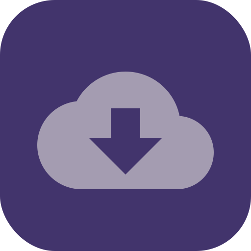
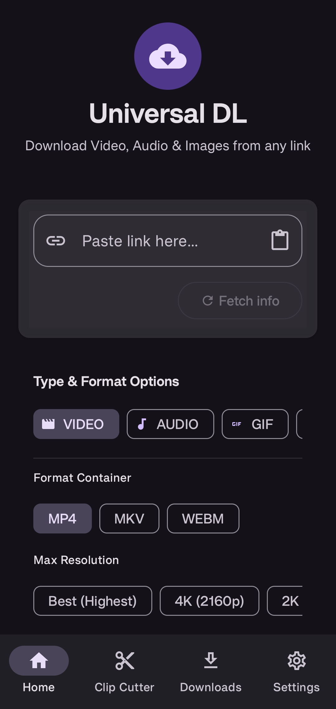

<div align="center">



# UniversalDL

### Download anything. From anywhere. In any format.

A powerful Android downloader for videos, audio, GIFs, and photos from YouTube, Facebook, Instagram, X (Twitter), and literally any site, with a built-in media player and a YouTube/Twitch clip cutter.

<br/>

[](https://github.com/SweetSamosa/UniversalDL/stargazers)
[](https://github.com/SweetSamosa/UniversalDL/releases)
[](https://github.com/SweetSamosa/UniversalDL/network/members)
[](https://github.com/SweetSamosa/UniversalDL/issues)

[](https://kotlinlang.org)
[](https://developer.android.com)
[](https://developer.android.com/jetpack/compose)
[](https://developer.android.com/about/versions/nougat)
[](https://github.com/SweetSamosa/UniversalDL/releases/latest)
[](LICENSE)
[](CONTRIBUTING.md)
[](https://github.com/SweetSamosa/UniversalDL/commits)
[](https://github.com/SweetSamosa/UniversalDL)

<br/>

[**Download APK**](https://github.com/SweetSamosa/UniversalDL/releases/latest) · [**Report Bug**](https://github.com/SweetSamosa/UniversalDL/issues) · [**Request Feature**](https://github.com/SweetSamosa/UniversalDL/issues)

</div>

---

## 📊 At a Glance

| ⭐ Stars | 📥 Downloads | 🧑‍💻 Language | 📱 Platform |
|:-------:|:------------:|:-------------:|:-----------:|
|  |  | **Kotlin** | **Android 7.0+** |

---

## ✨ Features

### 🎬 Download Anything
- **Videos**: MP4, WebM, MKV in multiple resolutions (144p → 4K)
- **Audio**: MP3, M4A, OPUS, WAV
- **GIFs**: save animated clips as GIFs
- **Photos**: download full-quality images and carousels

### 🌐 Works Everywhere
- YouTube, Facebook, Instagram, X (Twitter), TikTok, Twitch, Reddit
- Supports **1000+ websites** and basically any site with downloadable media
- Paste a link and go, with smart link detection

### ✂️ Clip Cutter
- Cut and trim clips from **YouTube**, **Twitch**, and other videos
- Choose exact start and end times
- Download only the part you want, with no need to save the full video

### 🎵 Built-in Player
- Integrated **music player** with background playback
- Integrated **video player** with gesture controls
- Play downloads instantly without leaving the app

### ⚡ Performance
- Fast, multi-threaded downloads
- Pause, resume, and queue management
- Background downloading with notifications

### 🎨 Modern Design
- Clean Material 3 interface
- Light and dark themes

---

## 📸 Screenshots

<div align="center">

| Home | Format Picker | Clip Cutter | Player |
|:---:|:---:|:---:|:---:|
|  |  |  | 

---

## 🚀 Getting Started

### Install
1. Go to the [**Releases**](https://github.com/SweetSamosa/UniversalDL/releases/latest) page
2. Download the latest `UniversalDL.apk`
3. Allow *Install from unknown sources* if prompted
4. Open the app, paste a link, and download

### Build from Source

```bash
# Clone the repository
git clone https://github.com/SweetSamosa/UniversalDL.git
cd UniversalDL

# Build the debug APK
./gradlew assembleDebug

# Install on a connected device
./gradlew installDebug
```

**Requirements**
- Android Studio (latest stable)
- JDK 17
- Android SDK 34

---

## 🛠️ Tech Stack

| Layer | Technology |
|-------|------------|
| Language | Kotlin |
| UI | Jetpack Compose + Material 3 |
| Async | Kotlin Coroutines + Flow |
| Media Playback | Media3 / ExoPlayer |
| Extraction | yt-dlp |
| Processing | FFmpeg |

---

## 📖 How to Use

1. **Copy** a link from any supported app or site
2. **Paste** it into UniversalDL (or share it directly to the app)
3. **Choose** format and quality: video, audio, GIF, or photo
4. *(Optional)* Use the **Clip Cutter** to select a time range
5. **Download** and play it in the built-in player

---

## 🗺️ Roadmap

- [x] Multi-site video and audio downloads
- [x] Built-in music and video player
- [x] Clip cutter for YouTube and Twitch
- [x] GIF and photo downloads
- [ ] Playlist and channel batch downloads
- [ ] Subtitle downloads
- [ ] Scheduled downloads

---

## 🤝 Contributing

Contributions are welcome!

1. Fork the project
2. Create your branch: `git checkout -b feature/AmazingFeature`
3. Commit your changes: `git commit -m "Add AmazingFeature"`
4. Push to the branch: `git push origin feature/AmazingFeature`
5. Open a Pull Request

---

## ⚠️ Disclaimer

UniversalDL is intended for **personal use only**. Please respect copyright laws and the terms of service of the platforms you download from. The developer is not responsible for any misuse of this app. Only download content you own or have permission to save.

---

## 📄 License

Distributed under the MIT License. See [`LICENSE`](LICENSE) for details.

---

## 👨‍💻 Author

**SweetSamosa**
GitHub: [@SweetSamosa](https://github.com/SweetSamosa)

---

<div align="center">

### ⭐ If you like UniversalDL, give it a star! ⭐

Made with ❤️ and Kotlin

</div>
